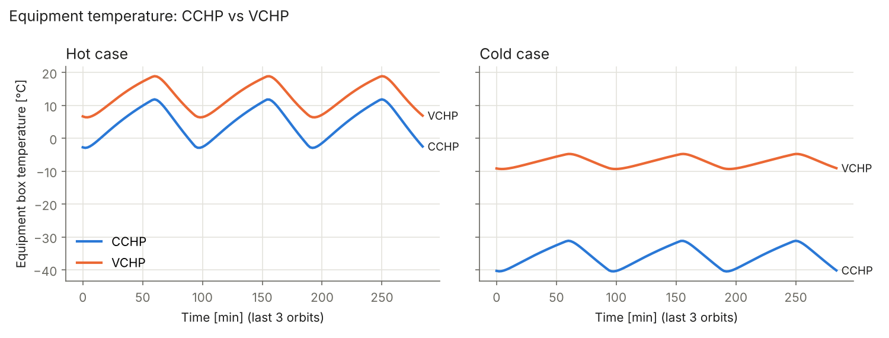
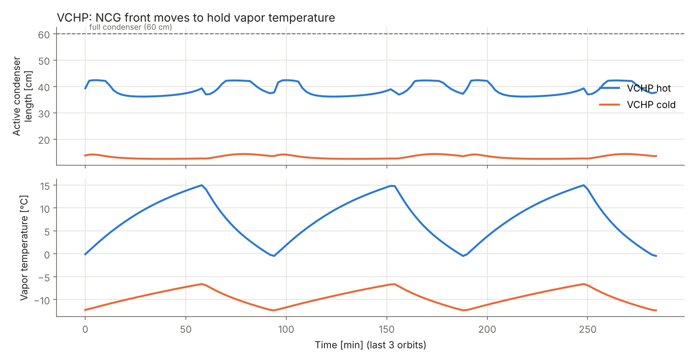
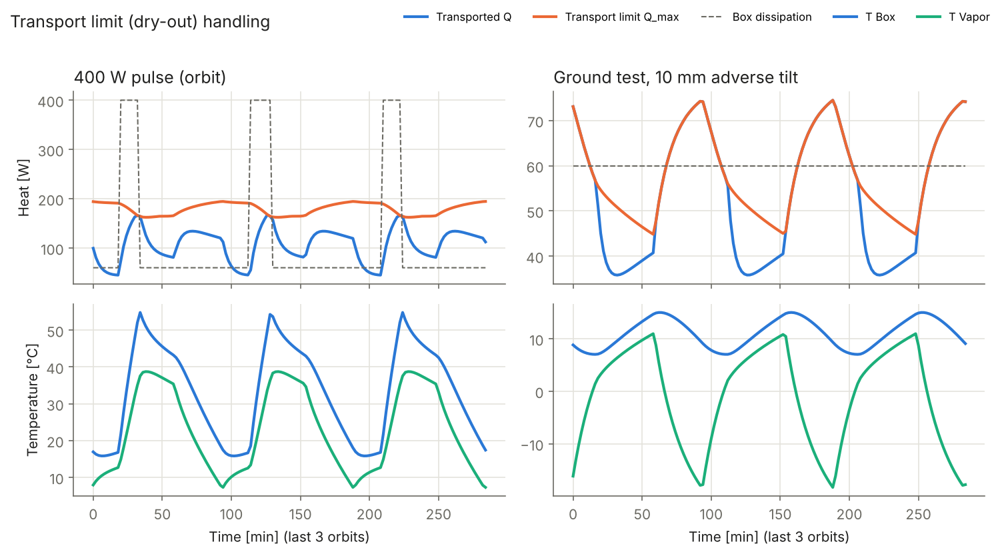

# CCHP / VCHP 사용자 서브루틴 – 물리 모델과 사용법

Space Systems Thermal(TMG 솔버)에서 **작동유체의 유동·상변화 현상을 반영한** 축방향 그루브(axial groove) 암모니아 히트파이프를 해석하기 위한 Fortran 서브루틴 모델입니다.

- **CCHP** (Constant Conductance Heat Pipe): 그루브 액체층 전도, 증기 유동 압력강하, 수송 한계(dry-out)
- **VCHP** (Variable Conductance Heat Pipe): 위 내용 + 비응축가스(NCG) flat-front 모델

> ⚠️ **현재 상태:** 물리 모델, 입력 파일 드라이버, 독립 검증까지 완료했습니다. **TMG USER1과의 실제 연결부(`user1_template.f90`의 TODO 3곳)는 아직 채우지 않았습니다.** USER1 인자 목록과 노드 온도/전도체 API는 NX2027 도움말에서 확인한 뒤 채워야 합니다(아래 5장).

---

## 1. 솔버와 연결하는 방식

솔버는 노드 온도(에너지 보존)를 풀고, 서브루틴은 **매 반복마다 전도체 값만 다시 계산해 써 넣습니다.**

```
 [증발부 벽 노드 i] ──G_evap(i)──┐                    ┌──G_cond(j)·f(j)── [응축부 벽 노드 j]
                                [증기 Tve]──G_vap──[증기 Tvc]
                                                          (NCG 저장조 노드 Tres)
```

| 전도체 | 물리 현상 | 계산 방법 |
|---|---|---|
| `G_evap(i)` | 증발부 벽 전도 + 그루브 액체층 전도(증발 막 저항) | 반경방향 직렬 저항, Chi의 그루브 유효 열전도도 |
| `G_cond(j)` | 응축부 벽 전도 + 액체층 전도(응축 막 저항) | 위와 같음 × VCHP 활성 비율 `f(j)` |
| `G_vap` | 증기 유동 압력강하 → 포화온도 강하 | Hagen-Poiseuille/Blasius + Clausius-Clapeyron |

증기 노드는 1개(Tve = Tvc, `vap_cond = 0`) 또는 2개로 둘 수 있습니다. 증기 노드는 산술 노드나 열용량이 작은 노드로 만듭니다.

## 2. 물리 모델

### 2.1 작동유체 물성
- 포화 암모니아, 200–380 K, CoolProp으로 만든 테이블(`fortran/src/hp_props_data.inc`)
- 포화압력은 ln P – 1/T 선형 보간, 나머지 물성은 T 선형 보간
- 범위를 벗어나면 끝값으로 고정하고 `out_of_range` 플래그를 세움 (암모니아 삼중점 195.5 K)

### 2.2 반경방향 전도 (증발/응축 막 저항)

단위 길이당 전도도:

$$G' = \frac{2\pi}{\dfrac{\ln(r_o/r_g)}{k_w} + \dfrac{\ln(r_g/r_v)}{k_{eff}}},\qquad r_g = r_v + \delta$$

그루브 유효 열전도도 (Chi, 1976), 핀 폭 $w_f = 2\pi r_v/N - w$:

$$k_{eff} = \frac{w_f k_l k_w \delta + w k_l (0.185 w_f k_w + \delta k_l)}{(w + w_f)(0.185 w_f k_w + \delta k_l)}$$

실제 증발은 핀 끝의 얇은 액막에서 집중적으로 일어나므로 이 식은 근사입니다. **`mult_evap`, `mult_cond`로 시험 데이터에 맞춰 보정하는 것을 전제로 합니다.**

### 2.3 압력 수지와 모세관 한계

$$\Delta P_{cap,max} = \frac{2\sigma\cos\theta}{w} \;\ge\; \Delta P_l(Q) + \Delta P_v(Q) + \rho_l g h$$

- **액체 귀환** $\Delta P_l$: 자유표면을 대칭면으로 보고 폭 $w$ × 높이 $2\delta$ 사각 덕트로 등가화했습니다. 층류 fRe는 Shah & London 식을 씁니다.
- **증기** $\Delta P_v$: Re < 2300이면 Hagen-Poiseuille, 그 이상은 Blasius(비압축)
- **중력** $\rho_l g h$: `elevation` = 증발부가 응축부보다 높은 높이. 궤도 해석은 0, 지상 열진공시험에서는 역경사 높이를 넣습니다.
- 유효 길이 $L_{eff} = L_a + (L_e + L_{c,active})/2$. VCHP는 활성 응축 길이를 씁니다.
- 증기 ΔP가 난류에서 비선형이므로 Q_cap은 이분법으로 풉니다.

### 2.4 기타 수송 한계

| 한계 | 식 | 비고 |
|---|---|---|
| 음속 | $A_v\rho_v h_{fg}\sqrt{\gamma R T/(2(\gamma+1))}$ | Levy/Busse |
| 비말동반 | $A_v h_{fg}\sqrt{\sigma\rho_v/(2 r_{h,w})}$, $r_{h,w}=w/2$ | |
| 점성 | $A_v r_v^2 h_{fg}\rho_v P_v/(16\mu_v L_{eff})$ | 저온 시동 시 지배 |
| 비등 | 고전식 (기본 꺼짐) | 그루브에서는 지나치게 보수적입니다. 제작사의 증발부 최대 열유속을 `q_flux_max`로 넣는 것을 권장합니다. |

### 2.5 수송 한계 초과 시 처리 (dry-out 근사)
수송 열량 Q가 $Q_{max}$를 넘으면 **증발부 전도체만** 계수 `scale`로 줄여 Q가 $Q_{max}$에 머물게 합니다. 응축부는 줄이지 않으므로 증기 온도는 응축부 쪽에 머물고, 남는 열은 장비(증발부) 온도 상승으로 나타납니다. 증발부 윅 건조가 실제로 일으키는 현상입니다.

### 2.6 VCHP – NCG flat-front 모델
- 전체 압력 = $P_{sat}(T_{vc})$
- NCG 구간의 증기 분압 = 벽 온도의 포화압 $P_{sat}(T_{wall})$
- 저장조 → 응축부 끝 구간부터 차례로 채워 나가며 NCG 몰수 합이 충전량이 되는 위치를 찾습니다:

$$n_k = \frac{\big(P_{sat}(T_{vc}) - P_{sat}(T_k)\big)V_k}{R\,T_k}$$

- 구간마다 온도가 달라도 됩니다. 응축부를 따라 생기는 온도 분포를 반영합니다.
- 충전량 설계: `charge_T_full`(완전 개방되는 증기 온도)과 `charge_T_res`(그때의 저장조 온도)를 주면 몰수를 계산합니다. `n_gas`로 몰수를 직접 넣을 수도 있습니다.
- 저장조 히터로 제어하는 VCHP는 저장조 노드에 솔버의 서모스탯 히터를 걸면 됩니다. 저장조 온도가 올라가면 NCG가 응축부로 밀려 나가 전도도가 떨어집니다.

### 2.7 수치 안정성
front 위치는 증기 온도에 매우 민감합니다(강성). 고정 완화로는 front가 구간 경계를 왕복하며 수렴하지 않는 경우가 생겨서, **Aitken(Irons-Tuck) 적응 완화**를 쓰고 완화계수가 한 번에 2배 넘게 커지지 않도록 막았습니다. 데모의 2,280개 시간 스텝 전부가 반복 36회 이내에 수렴했습니다.

## 3. 검증 결과

| 검증 | 방법 | 결과 |
|---|---|---|
| Fortran 구현 | 같은 식을 Python으로 독립 구현해 12개 온도·경사 조건 × 19개 물리량 비교 | 상대오차 1e-6 이내 통과 |
| 모세관 한계 | Fortran 이분법 vs Python 닫힌 해(층류 선형식) | 통과 |
| VCHP front | 균일 온도 조건의 해석해 $L_{blocked} = (nRT/\Delta P - V_{res})/A_v$와 비교 | 통과 (예: 27.694 cm vs 27.694 cm) |
| 입력 드라이버 | namelist + 노드/전도체 ID 매핑 결과 = 직접 호출 결과 | 통과 |

> 위 검증은 **구현이 식과 일치하는지**를 확인한 것입니다. **실제 히트파이프와 일치하는지(validation)**는 제작사 데이터나 열진공시험 결과로 따로 확인해야 합니다(6장).

## 4. 데모 (독립 과도 열해석)

장비 박스 → CCHP/VCHP → 라디에이터(0.6 m², 우주 복사) 모델을 95분 궤도(일조 60분)로 12궤도 계산했습니다. 기본 히트파이프는 Ø12.7 mm급 Al/암모니아 그루브 파이프이고, 증발부 0.3 m, 단열부 0.4 m, 응축부 0.6 m입니다.

| 케이스 | 장비 온도 (마지막 궤도) |
|---|---|
| 고온 CCHP | −2.9 ~ 11.8 °C |
| 고온 VCHP | 6.4 ~ 18.9 °C |
| 저온 CCHP | −40.5 ~ −31.2 °C |
| 저온 VCHP | **−9.4 ~ −4.8 °C** (NCG가 응축부를 막아 열 방출을 줄임) |





데모의 VCHP 충전 조건(증기 20 °C에서 완전 개방)에서는 고온 케이스에서도 완전히 열리지 않아 CCHP보다 따뜻합니다. **충전량과 저장조 체적은 고온 상한과 저온 하한 사이의 절충으로 정하는 설계 변수**이고, 이 모델로 바로 비교 검토할 수 있습니다.

수송 한계 처리: 400 W 펄스(궤도)와 지상시험 역경사 10 mm 케이스. 그루브 히트파이프는 1 cm 정도의 경사만으로도 모세관 압력 대부분을 중력 수두에 잃습니다.



## 5. Space Systems Thermal 연결 절차

1. **모델 준비** (NX Simcenter 3D)
   - 증발부/응축부 벽(새들) 노드를 구간별로 둡니다. 노드 분할이 서브루틴 구간 분할과 같아야 합니다.
   - 증기 노드(1~2개), VCHP면 저장조 노드를 둡니다.
   - 벽 노드 ↔ 증기 노드 사이 전도체를 미리 만듭니다(초기값은 아무 값이나 괜찮습니다). 히트파이프 벽의 축방향 금속 전도는 일반 전도체로 따로 모델링합니다.
2. **입력 파일**: `examples/hp_input.nml`을 복사해 노드/전도체 ID와 형상을 실제 값으로 바꿉니다.
3. **USER1 연결** – `fortran/src/user1_template.f90`
   - [TODO-1] NX2027 도움말의 USER1 예제 시그니처로 `USER1`을 작성하고 `hp_user1_entry(PHASE_*, time)`를 호출
   - [TODO-2] `tmg_get_temp`: TMG API로 노드 온도 읽기
   - [TODO-3] `tmg_set_cond`: TMG API로 전도체 값 쓰기
   - 확인할 것: 솔버가 반복마다 전도체를 다시 읽어 행렬을 재조립하는지, 온도 단위(K/°C)
4. **빌드**: 솔버가 지원하는 Fortran 컴파일러(보통 Intel Fortran)로 `hp_props.f90 → hp_model.f90 → hp_driver.f90 → user1_template.f90` 순서로 컴파일하고 DLL로 링크합니다. `hp_props_data.inc`가 include 경로에 있어야 합니다.
5. **솔버 설정**: 고급 파라미터 `ACTIVATE USER DLL SCHEME`, Solution > Thermal 탭 > Include File
6. **확인 순서**: 노드 3개짜리 단순 모델에서 로그(`hp_subroutine.log`)의 Q, Qmax, 활성 길이를 이 저장소 데모와 비교 → 실제 위성 모델 적용

## 6. 한계와 다음 단계

**현재 모델이 다루지 않는 것**
- NCG 확산에 의한 front 퍼짐: `blocked_frac`로 잔류 전도만 근사합니다.
- 증기 압축성(Ma > 0.2), 시동 중 동결/해동, 액체 슬러그·과충전 웅덩이(puddle)
- 그루브 형상의 정밀 모델: 사다리꼴·오메가 그루브, 메니스커스 후퇴에 따른 열저항 변화
- 루프 히트파이프(LHP)

**권장 다음 단계**
1. 대상 히트파이프의 제작사 데이터(형상, 전도도, 수송 능력 W·m)로 입력값을 확정하고 `mult_evap`/`mult_cond` 보정
2. USER1 TODO 3곳 구현 → 단순 모델로 연결 검증
3. 열진공시험 데이터로 상관관계 분석. 역경사 `elevation` 반영이 중요합니다.
4. 필요하면 저장조 히터 제어 로직(전력 제한, 다중 센서)으로 확장

## 참고 문헌
- Chi, S.W., *Heat Pipe Theory and Practice*, 1976 – 그루브 유효 열전도도, 수송 한계
- Faghri, A., *Heat Pipe Science and Technology*, 1995 – 압력 수지, 수송 한계 전반
- Marcus, B.D., *Theory and Design of Variable Conductance Heat Pipes*, NASA CR-2018, 1972 – VCHP flat-front 모델
- Shah, R.K. & London, A.L., *Laminar Flow Forced Convection in Ducts*, 1978 – 사각 덕트 fRe
- Bell, I.H. et al., CoolProp – 암모니아 물성
